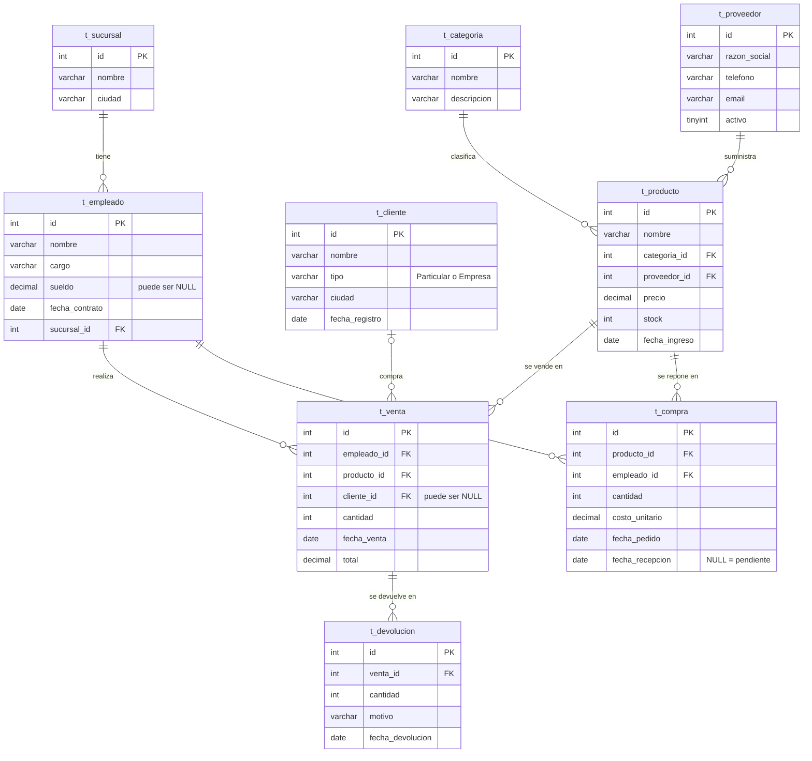

# Modelo Entidad-Relación — `ferreteria_elroble`

Estado de la base después de ejecutar los tres scripts de `scripts/`.

## Torpedo de `ON`

Regla: la FK (`algo_id`) se empareja con el `id` de la tabla a la que apunta, con alias distintos a cada lado.

| Unir… | ON |
|---|---|
| venta ↔ empleado | `venta.empleado_id = empleado.id` |
| venta ↔ producto | `venta.producto_id = producto.id` |
| venta ↔ cliente | `venta.cliente_id = cliente.id` |
| producto ↔ categoría | `producto.categoria_id = categoria.id` |
| producto ↔ proveedor | `producto.proveedor_id = proveedor.id` |
| empleado ↔ sucursal | `empleado.sucursal_id = sucursal.id` |
| compra ↔ producto | `compra.producto_id = producto.id` |
| compra ↔ empleado | `compra.empleado_id = empleado.id` |
| devolución ↔ venta | `devolucion.venta_id = venta.id` |
